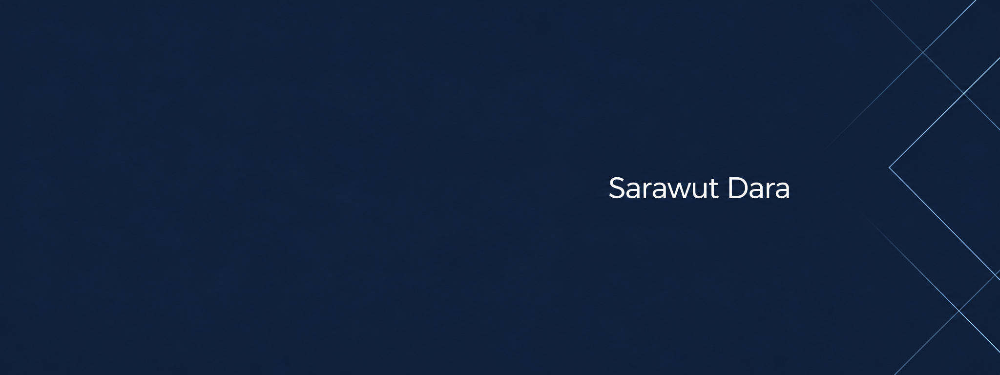

# Sarawut Dara

Computer Science student at **Prince of Songkla University**, Thailand.

I build web applications with Next.js, React, TypeScript, and Python, and explore practical uses of AI. I'm currently looking for an internship where I can learn and contribute to a team.

## Selected projects

### StockMarket

An English/Thai web app for following US stocks, managing watchlists, and reading AI-generated market news summaries.

**Next.js · TypeScript · MongoDB · Inngest · Gemini**  
[Source code](https://github.com/Valtheros/TradeingView) · [Live app — sign-in required](https://stockmarket-fdev.vercel.app/)

### AILAB

A no-code computer vision training platform. The web interface handles datasets and training configuration, while the backend queues training jobs and streams progress and results.

**Next.js · TypeScript · FastAPI · Python · Redis · PostgreSQL · Docker**  
[Frontend](https://github.com/Valtheros/AILAB-font) · [Backend](https://github.com/Valtheros/AILAB-Backend)

### Label Studio integration for AILAB

An AILAB integration based on the open-source [Label Studio](https://labelstud.io/) data annotation project. Credit for the original platform belongs to the Label Studio contributors.

[Integration repository](https://github.com/Valtheros/LabelstudioForAILAB)

## Tech stack

**Frontend:** Next.js, React, TypeScript, JavaScript, Tailwind CSS  
**Backend & data:** Python, FastAPI, PostgreSQL, MongoDB, Redis  
**Tools:** Git, Docker

## Recognition

- **Cyber Hero Chiang Rai CTF** — 5th place, university category.
- **NECTEC AI for Thai Service Onboarding** — Top-15 finalist with ILMU THAI.
- **ICPC Thailand National Contest** — Qualified through the regional selection.

## Contact

[LinkedIn](https://www.linkedin.com/in/sarawut-dara-72b470446/) · [fsarawut02@gmail.com](mailto:fsarawut02@gmail.com)
